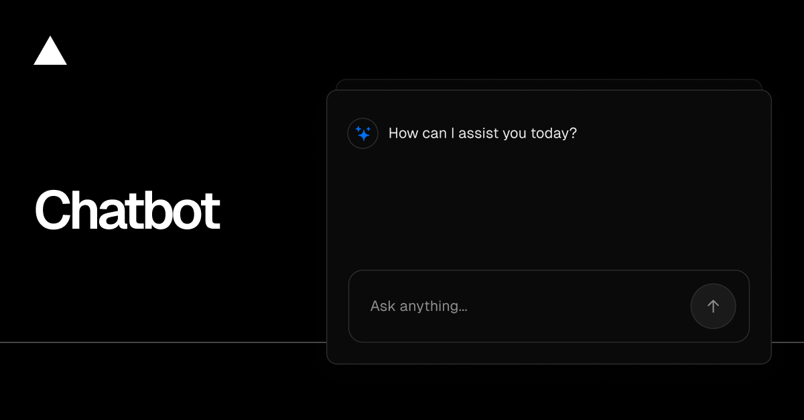

<a href="https://chat.vercel.ai/">
  
  <h1 align="center">Chatbot</h1>
</a>

<p align="center">
    Chatbot (formerly AI Chatbot) is a free, open-source template built with Next.js and the AI SDK that helps you quickly build powerful chatbot applications.
</p>

<p align="center">
  <a href="https://chatbot.dev"><strong>Read Docs</strong></a> ·
  <a href="#features"><strong>Features</strong></a> ·
  <a href="#model-providers"><strong>Model Providers</strong></a> ·
  <a href="#deploy-your-own"><strong>Deploy Your Own</strong></a> ·
  <a href="#running-locally"><strong>Running locally</strong></a>
</p>
<br/>

## Features

- [Next.js](https://nextjs.org) App Router
  - Advanced routing for seamless navigation and performance
  - React Server Components (RSCs) and Server Actions for server-side rendering and increased performance
- [AI SDK](https://ai-sdk.dev/docs/introduction)
  - Unified API for generating text, structured objects, and tool calls with LLMs
  - Hooks for building dynamic chat and generative user interfaces
  - Supports OpenAI, Anthropic, Google, xAI, and other model providers via AI Gateway
- [shadcn/ui](https://ui.shadcn.com)
  - Styling with [Tailwind CSS](https://tailwindcss.com)
  - Component primitives from [Radix UI](https://radix-ui.com) for accessibility and flexibility
- Data Persistence
  - [Neon Serverless Postgres](https://vercel.com/marketplace/neon) for saving chat history and user data
  - [Vercel Blob](https://vercel.com/storage/blob) for efficient file storage
- [Auth.js](https://authjs.dev)
  - Simple and secure authentication

## Model Providers

This template uses the [Vercel AI Gateway](https://vercel.com/docs/ai-gateway) to access multiple AI models through a unified interface. The default model is [OpenAI](https://openai.com) GPT-4.1 Mini, with support for Anthropic, Google, and xAI models.

### AI Gateway Authentication

**For Vercel deployments**: Authentication is handled automatically via OIDC tokens.

**For non-Vercel deployments**: You need to provide an AI Gateway API key by setting the `AI_GATEWAY_API_KEY` environment variable in your `.env.local` file.

With the [AI SDK](https://ai-sdk.dev/docs/introduction), you can also switch to direct LLM providers like [OpenAI](https://openai.com), [Anthropic](https://anthropic.com), [Cohere](https://cohere.com/), and [many more](https://ai-sdk.dev/providers/ai-sdk-providers) with just a few lines of code.

## Deploy Your Own

You can deploy your own version of Chatbot to Vercel with one click:

[](https://vercel.com/templates/next.js/chatbot)

## Running locally

You will need to use the environment variables [defined in `.env.example`](.env.example) to run Chatbot. It's recommended you use [Vercel Environment Variables](https://vercel.com/docs/projects/environment-variables) for this, but a `.env` file is all that is necessary.

> Note: You should not commit your `.env` file or it will expose secrets that will allow others to control access to your various AI and authentication provider accounts.

1. Install Vercel CLI: `npm i -g vercel`
2. Link local instance with Vercel and GitHub accounts (creates `.vercel` directory): `vercel link`
3. Download your environment variables: `vercel env pull`

```bash
pnpm install
pnpm db:migrate # Setup database or apply latest database changes
pnpm dev
```

Your app template should now be running on [localhost:3000](http://localhost:3000).

## Workspaces and plans

Every account receives a default workspace and can belong to multiple
workspaces. Workspace members have `owner`, `admin`, or `member` roles; owners
and admins can rename the workspace, manage member roles, add existing accounts,
and create seven-day invitation records. Pending invitations are not emailed or
self-service accepted yet. Chat and document data, subscription records, and
usage events are scoped to the validated active workspace. The `free` plan
includes 1,000 messages each month; paid plans use Stripe Checkout.

Apply `pnpm db:migrate` after setting `POSTGRES_URL` in `.env.local` to create
the workspace tables and backfill existing users, chats, and documents. Use
`/workspace` to manage a workspace and `/workspace/billing` to inspect its plan
and usage. New accounts and guest sessions are provisioned automatically.

### Stripe subscriptions

Set `STRIPE_SECRET_KEY`, `STRIPE_WEBHOOK_SECRET`, `STRIPE_PRICE_PRO`, and
`STRIPE_PRICE_BUSINESS` in `.env.local`. Set `NEXT_PUBLIC_APP_URL` to the
canonical production origin; Vercel's `VERCEL_URL` is used as a fallback. The
price variables must contain recurring monthly USD Price IDs created in Stripe,
not lookup keys. Create Pro at $19/month with lookup key `zooka_pro_monthly` and
Business at $49/month with lookup key `zooka_business_monthly`; store their Price
IDs in the corresponding environment variables. If Stripe keys or a Price ID
are missing, the pricing page disables that upgrade and explains which setting
is required. Configure a Stripe webhook pointing to `/api/webhooks/stripe` and
enable `checkout.session.completed` and
`customer.subscription.updated`. Checkout is restricted to workspace owners
and admins; the signed webhook synchronizes subscription status and plan into
the existing `Subscription` table. Enable `customer.subscription.deleted` as
well to synchronize cancellations. Pro and Business plans receive higher
hourly and monthly message limits plus access to advanced models. Stripe's
customer portal and cancellation UI are not implemented yet.
