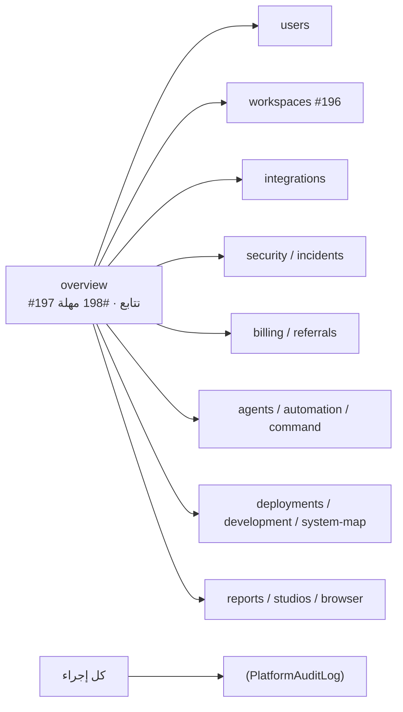

# ADMIN CONSOLE

19 صفحة تحت `/admin` + `/workspace/admin/{growth,n8n}`، ومسارات `/api/admin/{backup,growth,migrate,overview,users}`.

## المطلوب
- كل رقم في اللوحة من استعلام حقيقي؛ أي قسم بلا مصدر بيانات يُعلَّم COMING SOON.
- أعلام الميزات وزر الإيقاف الطارئ مكانهما `/admin/security`.
- `/admin/deployments` يعتمد على Vercel API — يحتاج توكن صالح.
