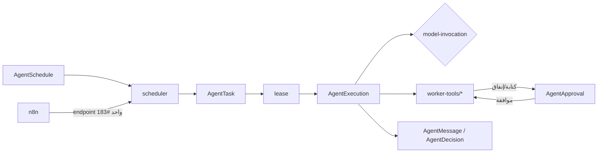

# AI AGENTS

| المكوّن | الملف | الحالة |
| --- | --- | --- |
| Worker | `lib/agents/worker.ts`, `worker-lease.ts` | يعمل (اختبارات وحدة) |
| Scheduler | `lib/agents/scheduler.ts`, `cron.ts`, `SchedulerRun` | جزئي (007 PARTIAL)؛ n8n يستدعي endpoint واحدًا (#183) |
| الموافقات | `lib/agents/approvals.ts`, `AgentApproval` | يعمل |
| اختيار النموذج | `lib/agents/agent-config.ts`, `model-invocation.ts` | مخزّن، التشغيل جزئي (006 PARTIAL) |
| الأدوات | `worker-tools/`: browser-task, github-inspect, project-document, studio-ai-generate, studio-media, studio-promo, vercel-inspect, workspace-readiness | 8 أدوات |
| الذاكرة | `agent_memory` | موجود |
| الهوية/النشر | `AgentIdentity`, `AgentDeployment`, `AgentLaunchPlan` | موجود |

## الفجوات
- إيقاف طارئ (platform + workspace) غير موجود.
- لا سجل إصدارات للوكيل (تغيير prompt/نموذج بلا تاريخ).
- النموذج المختار لا يصل دائمًا إلى التنفيذ.
