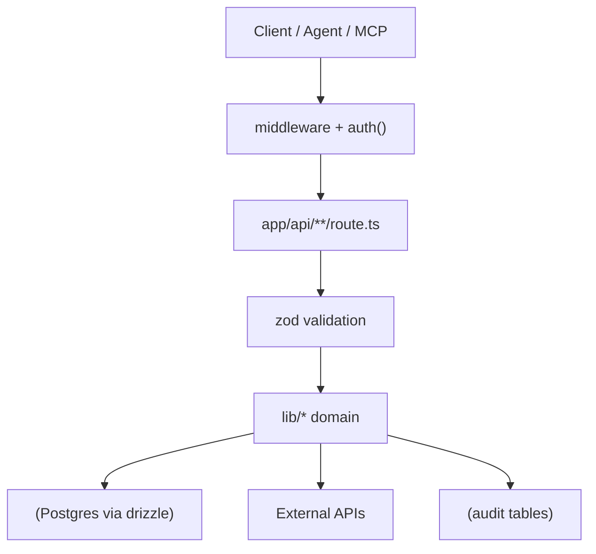

# API ARCHITECTURE

125 ملف `route.ts`. التوزيع الأكبر:

| البادئة | العدد التقريبي |
| --- | --- |
| `/api/workspace/*` | 15+ (browser 8، projects 4، documents) |
| `/api/integrations/*` | 25+ (tiktok 7، [provider] 5، n8n 3، google-drive 3، google-growth 3، x 2) |
| `/api/studio/*` | 15 |
| `/api/agents/*` | 12+ (tasks 5، schedules 3، approvals 3، registry) |
| `/api/admin/*` | backup, growth, migrate, overview, users |
| `/api/webhooks/*` | n8n, stripe, whatsapp |
| `(chat)/api/*` | chat, document, files, history, suggestions, vote |

## قواعد
- كل route يتحقق من الجلسة و`workspace_id` قبل أي قراءة.
- أخطاء قاعدة البيانات تُفحص عبر `lib/db/errors.ts` (PR #213) لأن drizzle 0.45 يغلّف `PostgresError`.
- `/api/health` و`/api/models` ترجع 401 بدون جلسة (متحقق على zooka-ai.com).
- مطلوب: OpenAPI مولّد من مخططات zod.
