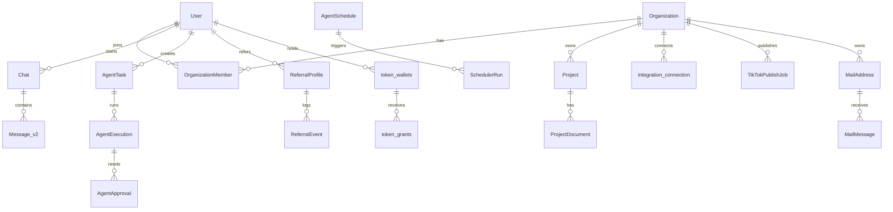

# DATABASE ARCHITECTURE

قاعدة محلية بعد `scripts/selfhost/migrate.ts`: **73 جدولًا، RLS مفعّل على 73، 61 سياسة**. آخر هجرة: `0067_signup_attribution` (#204).

## المجموعات
| المجال | الجداول |
| --- | --- |
| الهوية | User, Organization, OrganizationMember, Invitation, PlatformRole, PasswordResetToken, EmailVerificationToken, PhoneOtp, GuestUsage |
| المحادثة | Chat, Message, Message_v2, Vote, Vote_v2, Document, Suggestion, Stream |
| الوكلاء | AgentTask, AgentExecution, AgentApproval, AgentDecision, AgentMessage, AgentSchedule, SchedulerRun, AgentIdentity, AgentDeployment, AgentLaunchPlan, AgentProject, agent_memory |
| المتصفح | BrowserSession, BrowserEvent, BrowserEvidence |
| الاستوديو | StudioProject, StudioAsset, StudioSpendApproval, MediaJob, creative_credits, creative_usage |
| التكاملات | integration_connection, OAuthConnection, GoogleDriveConnection, N8nConnection, TikTok*, WebhookEvent, mcp_api_key |
| البريد | MailAddress, MailMessage, MailDraft, MailAttachment, MailAudit, EmailSuppression |
| الفوترة والنمو | Subscription, UsageEvent, token_wallets, token_grants, RewardLedger, Referral*, Affiliate, GrowthAudit, GrowthSettings, LaunchTestingClaim |
| المحتوى/الإدارة | BlogPost, publish_post, PlatformAuditLog, Base44AgentSession |

## الانحراف (Drift)
`docs/engineering/DATABASE_SCHEMA_DRIFT_REPORT.md` يسجل 15 جدولًا تُنشأ عبر `/api/admin/migrate` لا عبر هجرة مرقّمة، منها `integration_audit`, `usage_counter`, `integration_provider`, `billing_event`, `lead`, `price_snapshot`, `file`. تحقّقنا: قاعدة مهاجَرة من الصفر لا تحتوي `integration_audit` ولا `usage_counter`، بينما `lib/integrations/connectors/execute.ts` يكتب فيهما.

**الإصلاح المقترح (P1، يحتاج موافقة):** هجرة `0068` بـ `create table if not exists` مطابقة لـ DDL الإنتاج. لا يمكن كتابتها بدقة بدون قراءة مخطط الإنتاج (لا صلاحية Supabase حاليًا).

## قواعد
- لا هجرة إنتاجية بدون موافقة ونسخة احتياطية (`/api/admin/backup`).
- كل هجرة لها `.down.sql`.
- CI يشغّل الهجرات على PostgreSQL 16 قبل الاختبارات.
