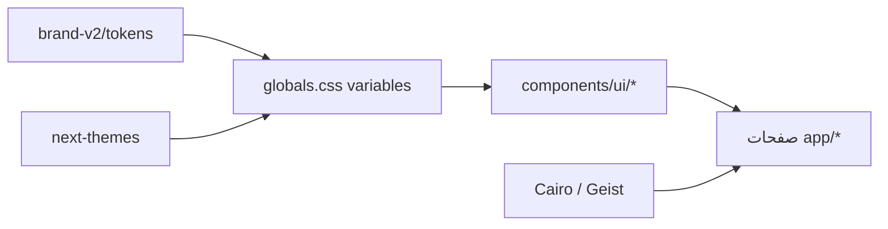

# DESIGN SYSTEM

الهوية الحالية معتمدة ولا تُغيَّر بدون مراجعة الأصول في `design/brand-v2/` (logo, icon, icons, tokens, gallery).

| الطبقة | المصدر في الكود |
| --- | --- |
| Tokens | `design/brand-v2/tokens/zooka-tokens.css` (مستورد في `app/layout.tsx`) + `tokens.ts` + متغيرات `app/globals.css` (`--background`, `--primary`, `--sidebar-*`, `--destructive`, ...) بنمط shadcn |
| الخطوط | `app/layout.tsx`: Cairo (عربي)، Geist، Geist Mono؛ `fontOf(lang)` في `lib/i18n.ts` |
| المكونات | 25 مكوّنًا في `components/ui/` (button, card, dialog, sheet, sidebar, select, tooltip, ...) |
| الثيم | `components/theme-provider.tsx` (next-themes) فاتح/داكن |
| الاتجاه | `dirOf(lang)` → `rtl` للعربية |

## الفجوات
- متغيرات shadcn في `globals.css` ومتغيرات `zooka-tokens.css` طبقتان منفصلتان؛ يلزم اختبار يتأكد أن ألوان shadcn مشتقة من tokens العلامة.
- لا صفحة كتالوج مكوّنات (Storybook أو مسار داخلي).
- مكوّن موحّد لشارة "COMING SOON" غير موجود؛ مطلوب للمبدأ FUNCTIONAL/COMING SOON.
