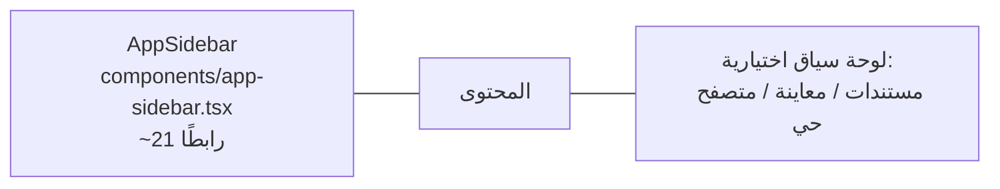

# DESKTOP UX

| العنصر | الحالة |
| --- | --- |
| Sidebar قابل للطي | موجود (`components/ui/sidebar.tsx`) |
| روابط sidebar | 21 رابطًا تشمل workspace, settings, studio, explore, platform-readiness |
| لوحة الأوامر | `components/ui/command.tsx` موجود؛ ربطه باختصار عام غير متحقق |
| تخطيط RTL | يعكس تلقائيًا عبر `dir` |

## المطلوب
- تجميع روابط الـ sidebar في أقسام (العمل · الإبداع · الإعدادات) لأن 21 رابطًا مسطّحًا كثير.
- اختصار `Ctrl/⌘+K` موحّد للتنقل.
