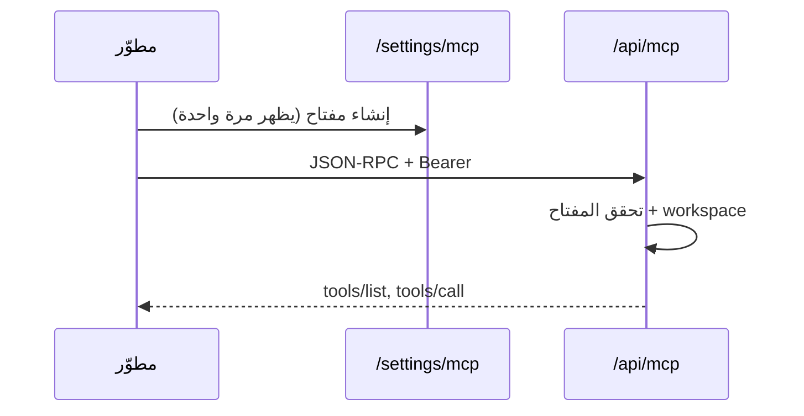

# DEVELOPER PLATFORM

| العنصر | الكود | الحالة |
| --- | --- | --- |
| MCP server | `app/api/mcp/route.ts`, `lib/mcp/server.ts`, `catalog.ts` | موجود |
| مفاتيح API | `app/api/mcp/keys/route.ts`, جدول `mcp_api_key`, `/settings/mcp` | موجود |
| بوابة المطورين | `/developer` | موجود |
| Webhooks واردة | `/api/webhooks/{n8n,stripe,whatsapp}` + `WebhookEvent` | موجود |
| Embed | `/embed` | موجود |
| OpenAPI | — | غير موجود |
| Rate limit لكل مفتاح | — | غير موثّق (يوجد throttle للمصادقة والبريد فقط) |

