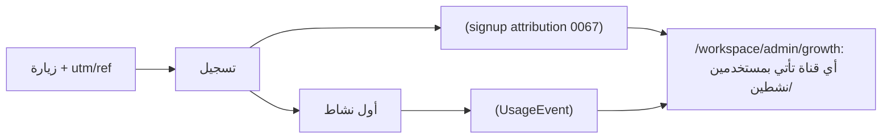

# GROWTH & ANALYTICS

| العنصر | الكود | الحالة |
| --- | --- | --- |
| قياس قنوات التسجيل | #204، هجرة `0067_signup_attribution` | مدمج؛ تطبيقه في الإنتاج غير متحقق |
| الإحالات | ReferralProfile/Event/Invite، `/admin/referrals` | موجود |
| المكافآت | RewardLedger، `/workspace/rewards` | موجود |
| Google Growth | `/api/integrations/google-growth` (3)، GrowthAudit, GrowthSettings | موجود |
| الاستهلاك | UsageEvent، `/workspace/usage`, `/settings/usage` | موجود |
| الشركاء | Affiliate، `/partners`, `/partners/join` | موجود |

## المطلوب
- لوحة تحويل: زيارة → تسجيل → أول مهمة → دفع.
- لا أرقام تجريبية تُعرض كحقيقية.
