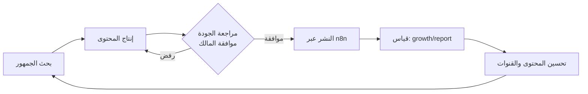

# ZOOKA-AI Growth Engine

الهدف ليس عدد الحسابات، بل عدد المستخدمين الحقيقيين: زائر ← تسجيل ← استخدام ← عودة.
هذه الوثيقة تحوّل "سولاس Social" من وكيل إنشاء حسابات إلى وكيل نمو، وتربط كل خطوة بما هو موجود فعلًا في الكود.

## الدورة

## المؤشرات: ما يُقاس اليوم وما لا يُقاس

| المؤشر | السؤال | المصدر في الكود | الحالة |
| --- | --- | --- | --- |
| Signups | كم شخصًا سجّل؟ ومن أي قناة؟ | `"User"."signupSource"` (هجرة 0067، #204) | يُقاس |
| Activation | كم مستخدمًا نفّذ عملًا حقيقيًا؟ | `"UsageEvent"` في `lib/growth/funnel.ts` | يُقاس |
| Retention | كم مستخدمًا نشط خلال 7 أيام؟ | `activeLast7d` في نفس الاستعلام | يُقاس (7 أيام فقط) |
| Website Visits | كم زائرًا؟ | `@vercel/analytics` مثبت، لكن لا API للقراءة | غير مقاس آليًا |
| Reach | كم شخصًا وصل إليه المحتوى؟ | يحتاج insights API لكل منصة | غير مقاس |
| Cost per Signup | تكلفة التسجيل | يحتاج حسابًا إعلانيًا مستقلًا لـ ZOOKA-AI | غير مقاس |

قاعدة: لا يُعرض رقم غير مقاس كأنه حقيقي. التقرير يُرجع حقل `notMeasured` صراحة.

## ما يضيفه هذا الـ PR (التكرار الأول)

| العنصر | الملف |
| --- | --- |
| واجهة قراءة للـ n8n (أرقام مجمّعة فقط، بلا بيانات شخصية) | `app/api/integrations/n8n/growth/report/route.ts` |
| حساب النسب وأفضل قناة | `lib/growth/report.ts` |
| باب ضيق في `proxy.ts`: POST فقط، مسار مطابق تمامًا | `proxy.ts` |
| سر مستقل `N8N_GROWTH_REPORT_SECRET` (ليس سر النشر) | `.env.example` |
| Workflow جاهز للاستيراد: تقرير أسبوعي كل اثنين 9:00 بتوقيت دبي | `docs/integrations/n8n-growth-engine/weekly-growth-report.json` |
| اختبارات | `tests/unit/growth-report.test.ts`, `tests/unit/n8n-service-boundary.test.ts` |

لا نشر، لا إنفاق إعلاني، لا كتابة في قاعدة البيانات.

## تشغيل الـ Workflow (إجراء المالك)
1. أنشئ سرًا: `openssl rand -hex 32`، وضعه في Vercel كـ `N8N_GROWTH_REPORT_SECRET` (Preview أولًا).
2. في n8n: Credentials ← Header Auth، الاسم `x-n8n-secret` والقيمة نفس السر.
3. استورد `weekly-growth-report.json` واربط عقدة "Read funnel" بهذا الـ credential.
4. أضف عقدة إرسال (بريد/Telegram) بعد "Summarise" حسب اختيارك.

## أولوية القنوات
| المرحلة | القنوات | السبب |
| --- | --- | --- |
| 1 | الموقع نفسه (SEO عربي/إنجليزي)، YouTube، LinkedIn، GitHub | جمهور الذكاء الاصطناعي والشركات والمطورين؛ القياس ممكن عبر `?ref=`/utm |
| 2 | Instagram، TikTok | عند اكتمال الحسابات رسميًا (TikTok publish موجود في الكود) |
| 3 | Pinterest | قناة بصرية إضافية فقط |

كل رابط منشور يحمل مصدرًا (`utm_source` أو `?ref=`) حتى يظهر في `signupSource` بدل `unknown`.

## بوابات الموافقة (لا تتغير)
- النشر العام: موافقة المالك لكل منشور أو لكل دفعة من التقويم.
- الإعلانات المدفوعة: ممنوعة حتى يوجد حساب إعلاني مستقل لـ ZOOKA-AI. الحساب الحالي يشغّل حملات Royal Haroon ولا يُخلط.
- برنامج الإحالة: موجود (`lib/growth/referrals.ts`، `RewardLedger`)؛ أي تغيير في المكافآت بقرار المالك.

## المراحل التالية
| # | العمل | يحتاج |
| --- | --- | --- |
| G2 | جدول تقويم محتوى (فكرة/مسودة/مراجعة/معتمد/محظور/منشور) مع موافقة | هجرة جديدة (موافقة) |
| G3 | استيراد reach من YouTube/LinkedIn/TikTok إلى جدول يومي | ربط الحسابات الرسمية |
| G4 | Workflow اقتراح تحسينات: يقارن القنوات أسبوعيًا ويقترح (لا ينفذ) | G2 + G3 |
| G5 | Cost per signup | حساب Meta Ads مستقل لـ ZOOKA-AI |

ملاحظة: تقويم المحتوى المذكور (61 جاهزة، 28 للمراجعة، 1 محظورة) غير موجود في المستودع ولا في سجل المحادثات المتاح؛ يجب استيراده من مصدره قبل G2 بدل إعادة إنشائه.
