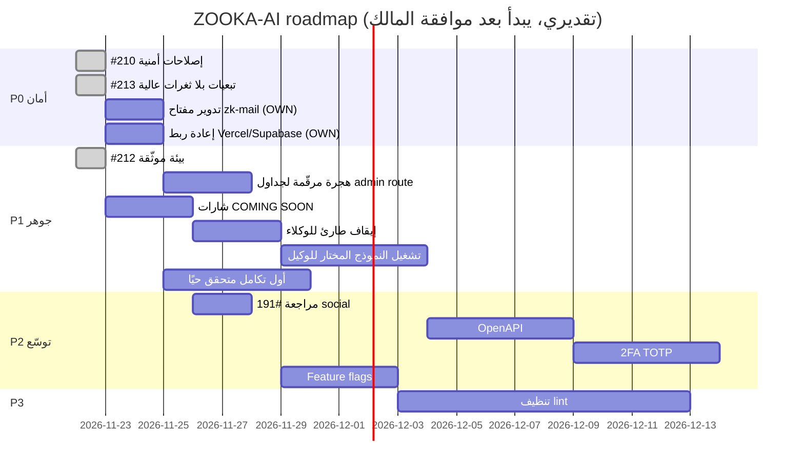

# IMPLEMENTATION ROADMAP

## المرحلة الأولى (التكرار الآمن الأول) — منفّذة كـ Draft PRs
| PR | النطاق | الحالة |
| --- | --- | --- |
| [#210](https://github.com/ZOOKA-AI/chatbot/pull/210) | ملاحظات أمنية + gate permissions + اختبار المتصفح | مفتوح للمراجعة |
| [#212](https://github.com/ZOOKA-AI/chatbot/pull/212) | `.env.example` كامل | مفتوح |
| [#213](https://github.com/ZOOKA-AI/chatbot/pull/213) | تبعيات + `lib/db/errors.ts` لـ drizzle 0.45 | Draft |
| هذا PR | وثائق `docs/product/` | Draft |

## المرحلة التالية المقترحة
P1-13 "شارات COMING SOON": جرد كل زر/صفحة في `/workspace/*` و`/settings/*` وربطه بحالة backend حقيقية (`lib/integrations/readiness.ts`, `live-status.ts`). لا يحتاج أسرارًا ولا هجرات.
