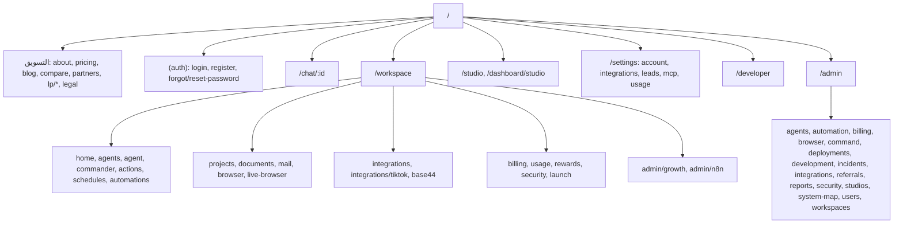

# INFORMATION ARCHITECTURE

مستخرج من `find app -name page.tsx` (80 صفحة) ومن `components/app-sidebar.tsx`.

## ملاحظات
- تداخل: `/workspace/agent` و`/workspace/agents` و`/workspace/commander`؛ و`/studio` و`/dashboard/studio` و`/workspace/studio`. يحتاج قرار دمج (لا حذف بدون موافقة).
- `/privacy` و`/privacy-policy` كلاهما موجود.
- `/social` غير موجود في `main` (Draft #191).
