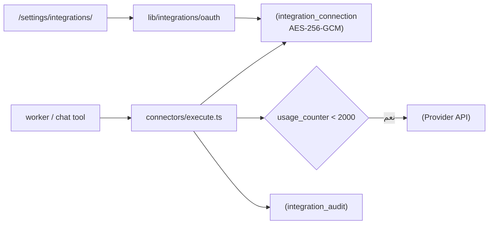

# INTEGRATIONS

المرجع: `docs/integrations-matrix.md` + `lib/integrations/*`. لا تكرار: كل مزود له مدخل واحد في `lib/integrations/connectors/registry.ts`.

| البند | القيمة |
| --- | --- |
| المزودون | 26 موثقًا، 24 منفّذًا، 2 غير منفّذين (Stripe كموصل، Google Maps) |
| التخزين | `integration_connection` لكل `workspace_id`، تشفير AES-256-GCM بمفتاح `TOKEN_ENCRYPTION_KEY` |
| التدقيق | `integration_audit` (قراءة/فشل/ربط/فصل) |
| العدّاد | `usage_counter` — حد 2000 قراءة شهريًا لكل مساحة |
| الكتابة | لا توجد عمليات كتابة في الموصلات التسعة؛ الوكيل لا ينشر ولا يرسل ولا ينفق عبرها |
| متحقق حيًا | 0 |

## مخاطر
- `integration_audit` و`usage_counter` و`integration_provider` لا تُنشأ بهجرة مرقّمة؛ على قاعدة جديدة تفشل `execute.ts` حتى يُشغَّل `/api/admin/migrate` (انظر DATABASE-ARCHITECTURE).
- Meta Ads (حساب المالك): الحساب الإعلاني المتاح يشغّل حملات Royal Haroon؛ لا يُربط بـ ZOOKA-AI. حملات ZOOKA تحتاج حسابًا إعلانيًا مستقلًا.
- Meta Ads (ميزة المنتج): الموصل موجود في `lib/integrations/facebook` و`instagram`؛ لا يُضاف تكامل ثانٍ.
- OpticOdds / Polymarket: غير مرتبطين بنطاق المنتج؛ لا يُضافان بدون قرار.
