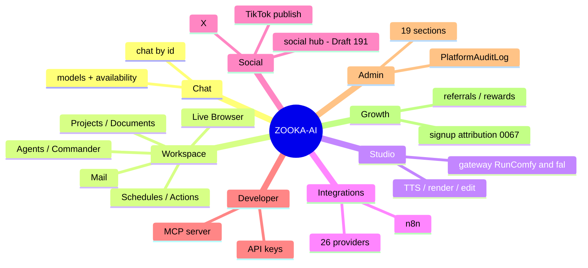

# MASTER PLAN — ZOOKA-AI

ZOOKA-AI منصة عربية أولًا (RTL افتراضي، `lib/i18n.ts`) لمساحات عمل يقودها وكلاء ذكاء اصطناعي: محادثة، وكلاء ينفّذون مهام بموافقة بشرية، استوديو إبداعي، بريد، تكاملات، ونشر اجتماعي.
هذه الوثيقة فهرس؛ التفاصيل في الملفات المجاورة. لا تبدأ من الصفر: الكود الحالي صالح (tsc 0، build ناجح، 1555 اختبارًا ناجحًا).

## الوثائق
| الملف | المحتوى |
| --- | --- |
| [CURRENT-STATE-AUDIT](CURRENT-STATE-AUDIT.md) | ما هو موجود فعلًا ومتحقق |
| [PRODUCT-REQUIREMENTS](PRODUCT-REQUIREMENTS.md) | مصفوفة الفجوات |
| [IMPLEMENTATION-ROADMAP](IMPLEMENTATION-ROADMAP.md) | المراحل والأولويات |
| [ACCEPTANCE-CRITERIA](ACCEPTANCE-CRITERIA.md) | شروط الإغلاق |
| [USER-JOURNEYS](USER-JOURNEYS.md) · [INFORMATION-ARCHITECTURE](INFORMATION-ARCHITECTURE.md) | الرحلات والهيكل |
| [DESIGN-SYSTEM](DESIGN-SYSTEM.md) · [MOBILE-UX](MOBILE-UX.md) · [DESKTOP-UX](DESKTOP-UX.md) | التصميم |
| [AI-AGENTS](AI-AGENTS.md) · [INTEGRATIONS](INTEGRATIONS.md) · [SOCIAL-ECOSYSTEM](SOCIAL-ECOSYSTEM.md) | القدرات |
| [DEVELOPER-PLATFORM](DEVELOPER-PLATFORM.md) · [API-ARCHITECTURE](API-ARCHITECTURE.md) · [DATABASE-ARCHITECTURE](DATABASE-ARCHITECTURE.md) | التقنية |
| [SECURITY-ARCHITECTURE](SECURITY-ARCHITECTURE.md) · [ADMIN-CONSOLE](ADMIN-CONSOLE.md) · [GROWTH-ANALYTICS](GROWTH-ANALYTICS.md) | التشغيل |

## خريطة المنتج

## قواعد التنفيذ
- لا نشر Production، لا دمج، لا هجرات إنتاجية بدون موافقة المالك.
- كل PR يبدأ Draft ويحمل دليل اختبار.
- كل ميزة معروضة إما FUNCTIONAL أو مُعلَّمة COMING SOON.
- لا أسرار Royal Haroon أو أي مشروع آخر داخل ZOOKA-AI.
