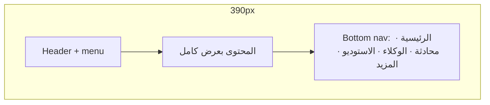

# MOBILE UX

| العنصر | الحالة | الدليل |
| --- | --- | --- |
| شريط سفلي | موجود | `components/mobile-bottom-nav.tsx` (`grid-cols-5`، روابط home, /, agents, studio) |
| PWA | موجود | `app/manifest.ts`, `public/sw.js`, `public/icons` |
| Sidebar كـ sheet | موجود | `components/ui/sidebar.tsx`, `sheet.tsx` |
| اختبار جوال آلي | غير موجود | لا Playwright mobile project |

## المطلوب
- مشروع Playwright بعرض 390px يمر على كل صفحات `/workspace/*` ويفشل عند التمرير الأفقي.
- أهداف لمس ≥ 44px في الشريط السفلي والجداول.
- جداول الإدارة تتحول إلى بطاقات على الجوال.
