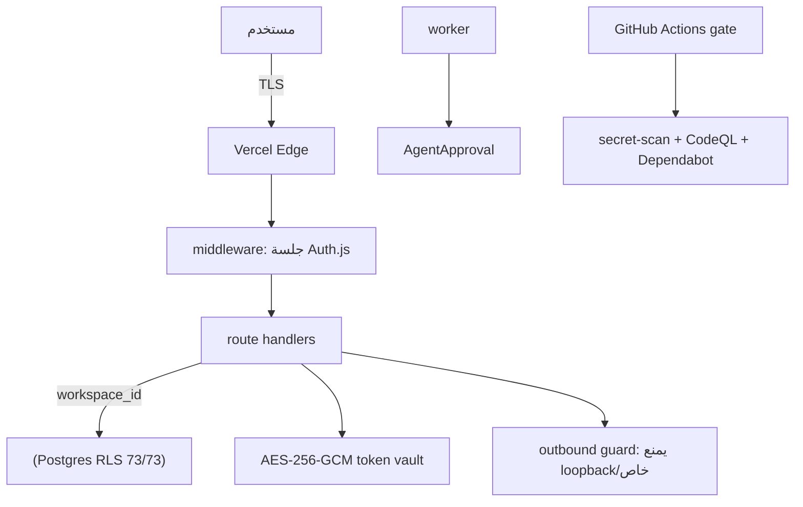

# SECURITY ARCHITECTURE

| الطبقة | الحالة | الدليل |
| --- | --- | --- |
| المصادقة | Auth.js: Google, Facebook, credentials, phone OTP, guest | `app/(auth)`, `lib/auth/*` |
| التقييد | throttle للمصادقة والبريد | `lib/auth/throttle.ts`, `lib/mail/rate-limit.ts` |
| الأدوار | PlatformRole + سياسة | `lib/auth/platform-role-policy.ts` |
| العزل | RLS على كل الجداول؛ runtime role منفصل (`zooka_runtime`) | الهجرات 0048/0049/0057/0058 |
| الأسرار | لا أسرار في الكود؛ allowlist ينتهي 2026-12-02 | `.github/secret-scan-allow.txt` |
| حماية الشبكة الصادرة | منع loopback قبل فتح المتصفح | `tests/unit/outbound-guard.test.ts` |
| موقف الأمان | `lib/security/posture.ts`، `/workspace/security`، `/admin/security` | موجود |

## مفتوح
| # | البند | المالك |
| --- | --- | --- |
| S1 | تدوير مفتاح zk-mail المسرّب في تاريخ git | OWN |
| S2 | دمج #210 و#213 | OWN (مراجعة) |
| S3 | 2FA | ENG |
| S4 | إيقاف طارئ للوكلاء | ENG |
| S5 | مراجعة تنبيهات CodeQL الـ 14 (SSRF في outbound guard غالبًا إيجابي كاذب) | ENG |
