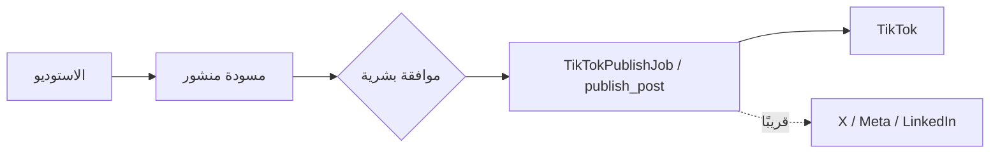

# SOCIAL ECOSYSTEM

| القناة | الكود | الحالة |
| --- | --- | --- |
| TikTok | `lib/integrations/tiktok/*`, `TikTokConnection`, `TikTokUpload`, `TikTokPublishJob/Event` (0065)، `/workspace/integrations/tiktok`، 7 مسارات API | منفّذ، يحتاج حسابًا حيًا |
| X | `lib/integrations/x`, 2 مسارات API | قراءة (`me`, `recent_posts`) |
| Facebook / Instagram | `lib/integrations/facebook`, `instagram` | قراءة |
| LinkedIn / Snapchat / Telegram | `lib/integrations/linkedin`, `snapchat`, `telegram-bot`, `telegram-ads` | منفّذ جزئيًا |
| نشر عام | `publish_post`, `/api/publish` | موجود |
| حسابات ZOOKA الرسمية | الفوتر (#195)، `/social` (Draft #191) | جزئي |

## الفجوات
- تقويم محتوى وجدولة منشورات: غير موجود.
- النشر على X/Meta/LinkedIn: قراءة فقط اليوم — يجب عرضه COMING SOON.
