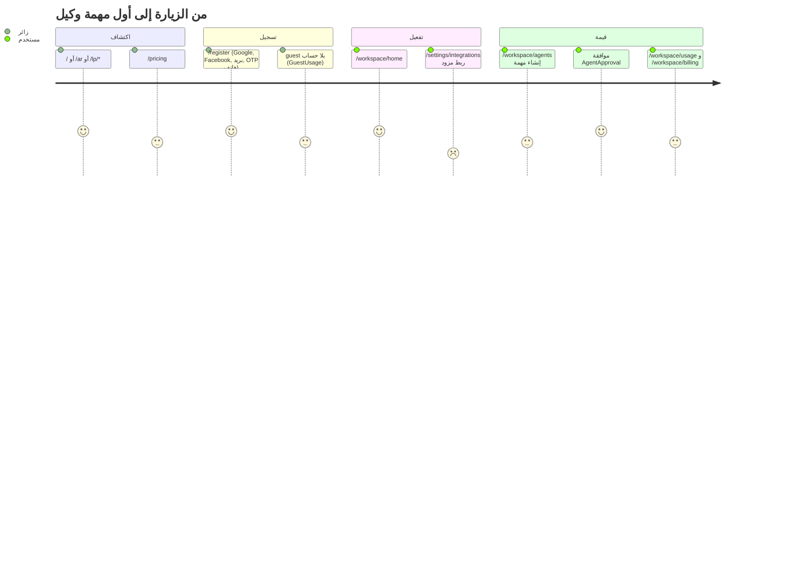
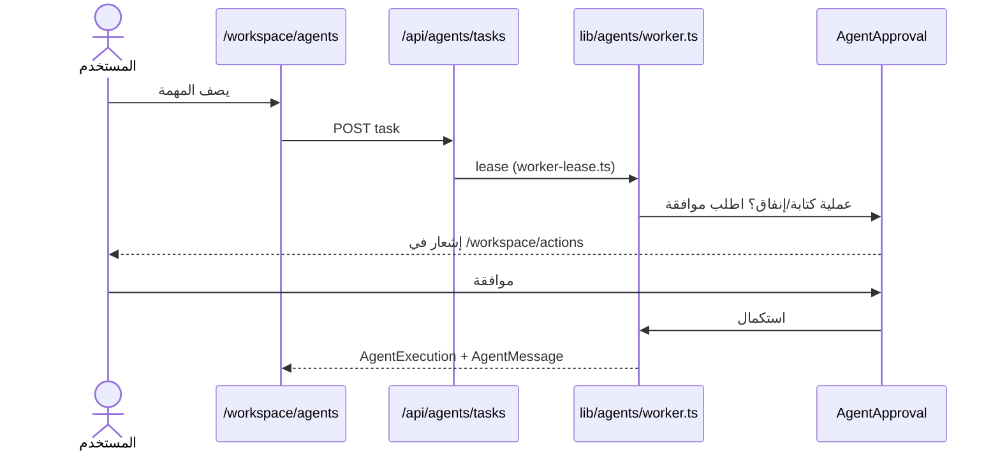

# USER JOURNEYS

الرحلات مبنية على المسارات الموجودة فعلًا في `app/`.

## زائر → مستخدم نشط

الفجوة: لا onboarding موجّه بعد التسجيل (`onboarding` يظهر فقط في الصفحة التسويقية و`integration-setup`).

## مهمة وكيل بموافقة

## مالك المنصة
`/admin` → overview (#197/#198) → users/workspaces (#196) → integrations/security/incidents → `/workspace/admin/growth` (قياس القنوات #204).
